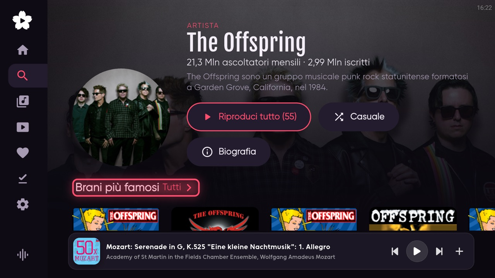
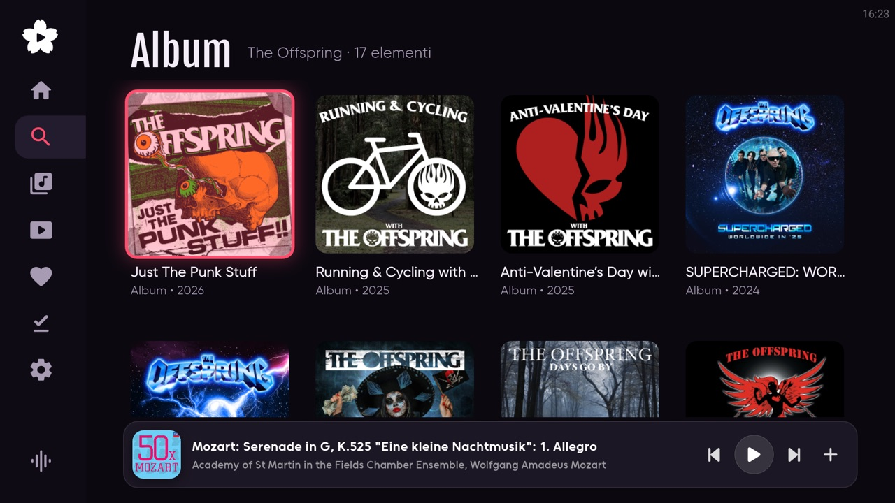
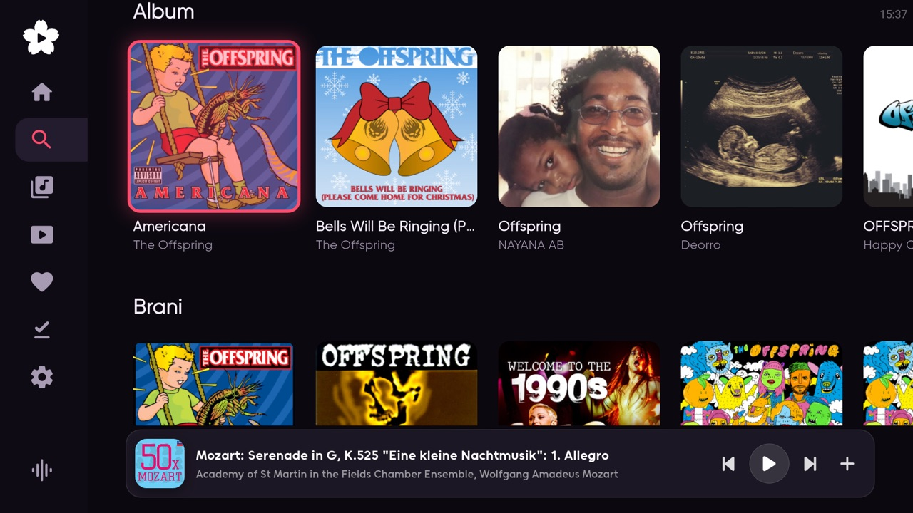
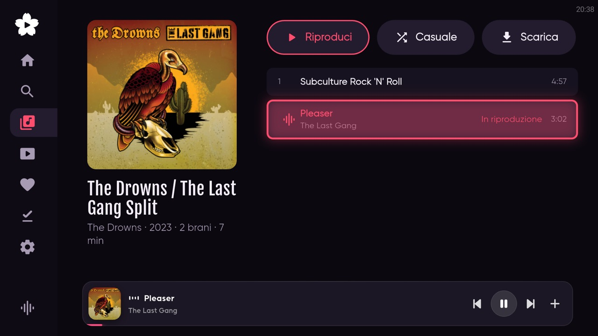

# 📺 Bloomee TV

A music player for Android TV and Google TV, built to be used from the sofa with the remote. It brings together streaming from YouTube Music, your own library on Jellyfin and downloads through Lidarr, in one interface designed for the big screen. The interface is in Italian.

Bloomee TV is a fork of [BloomeeTunes](https://github.com/HemantKArya/BloomeeTunes) 3.0.4 by HemantKArya: the player engine, the plugin system, lyrics, equalizer and much more come from Bloomee. I rebuilt the interface for the TV and added the integrations I needed at home.

<p align="center">
  
  
  
  
</p>

## Features

**Made for the remote**
- Side menu always one arrow away, pages made of rows, focus that moves one row at a time and is always visible.
- Player bar at the bottom reachable from every page, full screen player with queue, lyrics and equalizer.
- Voice search and an on-screen grid keyboard.

**Search and artists**
- Search with YouTube Music, results split into artists, albums, songs and playlists, with filters for each type.
- Artist pages with monthly listeners, biography, top songs, albums, singles and EPs, videos and similar artists; every row opens the complete list.

**Your music**
- Sign in with Google on the TV to get your YouTube Music history, liked songs, playlists, saved albums, followed artists and personalized home.
- Jellyfin library ("La tua musica") with direct streaming; Jellyfin results also appear in search.

**Downloads**
- "Scarica" on every album and playlist: **Locale** saves the tracks on the TV for offline listening, **Lidarr** sends the album to your Lidarr server so it shows up in Jellyfin.

**From Bloomee**
- Ad-free streaming through plugins, daily charts, synced lyrics, 10-band equalizer, crossfade, Last.fm scrobbling, library backup and restore.

## Install

Download the `armeabi-v7a` APK from the [latest release](https://github.com/fabiodalez-dev/BloomeeTV/releases/latest) and sideload it, for example with `adb install`. It works on Chromecast with Google TV and most ARM TV boxes; updates install over the previous version and keep your settings.

Jellyfin, Lidarr and the Google sign-in are configured in **Impostazioni** on the TV and stay on the device: nothing is bundled in the APK. "Controlla aggiornamenti" checks this repository's releases.

## Building

Bloomee TV is a Flutter app with a Rust core, like the original project. Build the TV APK with:

```
flutter build apk --release --target-platform android-arm --split-per-abi
```

## Issues

Bugs and ideas about Bloomee TV go in this repository's [issues](https://github.com/fabiodalez-dev/BloomeeTV/issues), not in the original Bloomee project.

## Credits and license

Bloomee TV is based on [BloomeeTunes](https://github.com/HemantKArya/BloomeeTunes) by [HemantKArya](https://github.com/HemantKArya); all credit for the original app goes to him. Like the original, this fork is released under the [GPL-2.0](LICENSE) license.
